  

# Team Assignments and Commit Plan

Roles are from `team-assignments.png`.

| Member | Role | Owns |
|---|---|---|
| Ezekiel Lazaro | Project Manager / Fullstack | Repo setup, README, tests, CLI, tkinter window, merging |
| Mark Aldred Magtibay | Backend | Data model, validation, FCFS, SJF, SRTF (`cpu_scheduler.py`) |
| Red Sepillo | Backend | Round Robin, run_all, `simulate()`, HTTP server (`web_ui.py`) |
| Stephen Andre Glovo | Frontend | HTML layout and CSS in `web_ui.py` |
| Hannah Catapang | Frontend | JavaScript, Gantt chart and results display in `web_ui.py` |

# CPU Scheduling Simulator (PT 101 - Topic 2)
FCFS, SJF (non-preemptive), SRTF (preemptive), Round Robin. Python 3.9+, no extra installs.

## Run in VS Code
1. File > Open Folder... > this folder. Install the **Python** extension.
2. Press **F5** and pick *Run GUI*, *Run CLI* or *Run Tests*
   (or in the terminal: `python cpu_scheduler.py`, `python cpu_scheduler.py --cli`,
   `python -m unittest -v test_cpu_scheduler`).
3. *Run GUI* starts the simulator and opens it in your browser (http://127.0.0.1:8765).
   Press Ctrl+C in the terminal to stop it.
4. Optional simple tkinter window: `python cpu_scheduler.py --tk`.

## Inputs
Process ID, Arrival Time (>= 0), Burst Time (> 0), Time Quantum (> 0, RR / Compare All).

## Output interpretation
Gantt chart (Idle = CPU gap), per-process AT, BT, CT, TAT = CT-AT, WT = TAT-BT,
RT = first start-AT, averages, RR slice trace, and an algorithm comparison.
RR tie rule: a preempted process is queued before a process arriving at the same instant.
